
<b>Full experience and education</b>

| Role | Organization | Dates |
| --- | --- | --- |
| Chief Technology Officer | Counslo Educating Generations · Part-time | Oct 2026 – Present |
| International Career &amp; Application Support Consultant | Counslo Educating Generations · Part-time | Oct 2026 – Present |
| Freelance Web &amp; AI Automation Developer | Self-employed | Feb 2026 – Present |
| Research &amp; Development Intern | Counslo Educating Generations | Aug – Oct 2025 |
| E-Commerce &amp; Data Manager | Prime Information Technology Group | Jan – Aug 2025 |

### Education

| Qualification | Institution | Period | Result |
| --- | --- | --- | --- |
| Bachelor of Science in Computer Science (BSCS) | University of Southern Punjab, Multan | 1 Mar 2022 – 28 Feb 2026 | CGPA 3.25 · 45 courses completed |
| Intermediate (FSc Pre-Engineering) | Global H.S.S. of Science (For Boys), Mailsi · BISE Multan | 2018–2020 | Marks 577 / 1,100 |
| Matriculation (Science) | Govt. Public High School Dokota, Mailsi · BISE Multan | 2016–2018 | Marks 933 / 1,100 · Grade A+ |


<a href="https://maharhammadhussainsial.vercel.app/">
  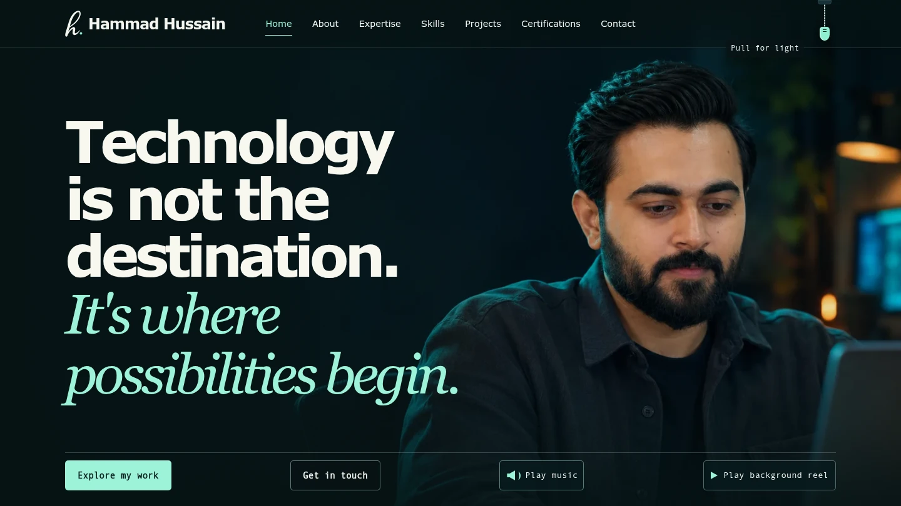
</a>

<a href="https://kps-school-portal.vercel.app/login">
  
</a>

<a href="https://superior-portal-management.vercel.app/">
  
</a>

<a href="https://counslo-website.vercel.app/">
  
</a>

<a href="https://maharhammadhussainsial.vercel.app/#agentic-ai-project-manager">
  
</a>

<a href="https://maharhammadhussainsial.vercel.app/#whatsapp-personal-assistant">
  
</a>

### Client portfolio websites

<a href="https://dr-anshakhadim.space-z.ai/">
  
</a>




<b>Other projects</b>

<a href="https://maharhammadhussainsial.vercel.app/#instagram-sales-support">
  
</a>

<a href="https://lms.khatoonepakistan.workers.dev/">
  
</a>

<a href="https://ai.hammadfidasial.workers.dev/">
  
</a>




<b>View all certificates, credential IDs & verification links</b>

### 🌍 One Million Prompters

**Certificate of completion** · Dubai Future Foundation & Dubai Centre for Artificial Intelligence  
Training in prompt engineering for AI systems.  
**Credential ID / verification link:** Not printed on the supplied certificate.

### 🧠 BeyondTahir Academy · 10 Certificates

Issued **22 October 2026**. Document types are shown as printed on the certificates. Verification links were decoded directly from their QR codes; current verification results have not been independently confirmed.

| Programme | Certificate type | Credential ID | Verification |
| :--- | :--- | :--- | :--- |
| Introduction to Generative AI | Completion | BTA-2026-1124C2 | [Verify](https://academy.beyondtahir.com/verify/BTA-2026-1124C2) |
| AI Agents & Automation for Beginners | Completion | BTA-2026-9AED1E | [Verify](https://academy.beyondtahir.com/verify/BTA-2026-9AED1E) |
| AI for Content Creation | Completion | BTA-2026-3F909A | [Verify](https://academy.beyondtahir.com/verify/BTA-2026-3F909A) |
| RAG Engineering: Build AI That Knows Your Data | Completion | BTA-2026-782D2C | [Verify](https://academy.beyondtahir.com/verify/BTA-2026-782D2C) |
| Intro to AI for Humans | Completion | BTA-2026-FB72E5 | [Verify](https://academy.beyondtahir.com/verify/BTA-2026-FB72E5) |
| Certification in Prompt Engineering (BTA-CPE) | Appreciation | BTA-2026-17D3EE | [Verify](https://academy.beyondtahir.com/verify/BTA-2026-17D3EE) |
| No Code: Build Anything Without Coding | Appreciation | BTA-2026-298135 | [Verify](https://academy.beyondtahir.com/verify/BTA-2026-298135) |
| AI for Students: From Learning to Earning | Appreciation | BTA-2026-3C64DC | [Verify](https://academy.beyondtahir.com/verify/BTA-2026-3C64DC) |
| AI for Doctors & Researchers | Appreciation | BTA-2026-5EC1E7 | [Verify](https://academy.beyondtahir.com/verify/BTA-2026-5EC1E7) |
| Applied AI in Law | Appreciation | BTA-2026-70F1D3 | [Verify](https://academy.beyondtahir.com/verify/BTA-2026-70F1D3) |

### 🎨 NDA Digital Skills · 6 Certificates

Six **1.5-month courses**, with certificates of completion issued **6 June 2026**.

| Programme | Credential ID |
| :--- | :--- |
| AI Social Media Marketing | 22840 |
| Canva & Freelancing | 57595 |
| Microsoft Office | 96386 |
| SEO Content Writing With AI | 48617 |
| Spoken English | 38966 |
| Video Editing & AI | 10469 |

**Verification:** Open the [official NDA portal](https://portal.nda.com.pk/), choose **Certificate Verification**, and enter the credential ID. These IDs are transcribed from my digital certificates; online acceptance has not been confirmed.

### ☁️ Additional Training

**Introduction to Generative AI Studio** · Google Cloud course via Simplilearn SkillUP · 2026  
*Listed in my resume. Credential ID and verification link were not available in the reviewed materials.*

| Additional training | Provider | Date or status |
| --- | --- | --- |
| Huawei Certified Cloud Developer Associate – AI (HCCDA-AI) | Corvit Systems, Multan | 2026 · Training in progress |
| Cisco Certified Network Associate (CCNA) | Corvit Systems, Islamabad | 2021 |
| Microsoft Certified Systems Engineer (MCSE) | Corvit Systems, Islamabad | 2021 |

[Browse the 21 credentials and courses on my portfolio](https://maharhammadhussainsial.vercel.app/#certifications).


  
  
  
  
  

