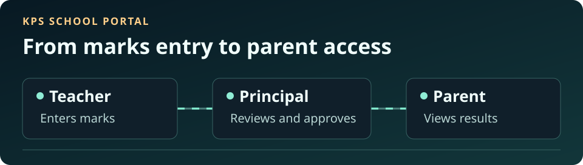
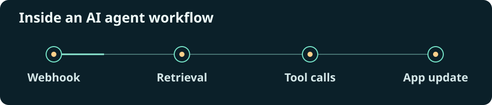

  
  
  

  <a href="#selected-work">Selected work</a> · <a href="#toolkit">Toolkit</a> · <a href="#experience">Experience</a> · <a href="#education--credentials">Education &amp; credentials</a> · <a href="#github-activity">GitHub activity</a>

## About

I build AI agents, automation workflows, and full-stack applications for customer support, sales, and daily operations. My work includes RAG assistants, voice agents, CRMs, and SaaS applications that connect with WhatsApp, Instagram, Messenger, and Google Workspace.

## Selected work

### KPS School Portal

School management portal for Khatoon-e-Pakistan Government Girls Secondary School in Karachi. Staff manage enrollment, attendance, timetables, and exam marks. Parents can see published results for their linked children.

`Next.js` · `TypeScript` · `Supabase` · `Vercel` · [Open portal](https://kps-school-portal.vercel.app/login)

### Other projects

| Project | What it does |
| :--- | :--- |
| **Agentic AI Project Manager** | Suggests task assignments and deadlines for a final-year project. |
| **Counslo Admissions Platform** | Organizes study-abroad applications and consultancy workflows. |
| **WhatsApp Personal Assistant** | Handles email, contacts, and calendar requests from a WhatsApp conversation using n8n and Meta APIs. |
| **Instagram Sales & Support** | Handles support, voice messages, and order intake, and extracts payment details from images. |
| **School Management System** | Manages attendance, marks, and report cards. |
| **AI Automation Portfolio** | Showcases services and projects and accepts document requests. |

[See the full portfolio](https://maharhammadhussainsial.vercel.app/)

## Toolkit

| Area | Tools and techniques |
| :--- | :--- |
| **AI agents & retrieval** | RAG, tool calling, prompt engineering, vector databases |
| **Workflow automation** | n8n, Python, webhooks, Google Workspace |
| **Application development** | Next.js, TypeScript, REST APIs, SQL, Git, GitHub |
| **Messaging integrations** | Meta APIs, WhatsApp, Instagram, Messenger |
| **Cloud & data** | Supabase, Vercel, Cloudflare, Firebase |
| **AI-assisted development** | Codex, Claude Code, Chat Z AI, Lovable, Trae |

## Experience

**E-commerce & Data Manager**  
**Prime Information Technology Group** · Multan  
`JAN — AUG 2025`

> Managed website maintenance, online retail operations, and product and business data.

**Research & Development Intern**  
**Counslo** · Multan  
`AUG — OCT 2025`

> Researched study-abroad options and student career pathways to support counselling.

## Education & Credentials

**BS Computer Science** · University of Southern Punjab · 2022–2026

**One Million Prompters** · **BeyondTahir Academy** (10 certificates) · **NDA Digital Skills** (6 certificates) · **Google Cloud Generative AI Studio**

<b>View all certificates, credential IDs & verification links</b>

### 🌍 One Million Prompters

**Certificate of completion** · Dubai Future Foundation & Dubai Centre for Artificial Intelligence  
Training in prompt engineering for AI systems.  
**Credential ID / verification link:** Not printed on the supplied certificate.

### 🧠 BeyondTahir Academy · 10 Certificates

Issued **22 October 2026**. Document types are shown as printed on the certificates. Verification links were decoded directly from their QR codes; current verification results have not been independently confirmed.

| Programme | Certificate type | Credential ID | Verification |
| :--- | :--- | :--- | :--- |
| Introduction to Generative AI | Completion | BTA-2026-1124C2 | [Verify](https://academy.beyondtahir.com/verify/BTA-2026-1124C2) |
| AI Agents & Automation for Beginners | Completion | BTA-2026-9AED1E | [Verify](https://academy.beyondtahir.com/verify/BTA-2026-9AED1E) |
| AI for Content Creation | Completion | BTA-2026-3F909A | [Verify](https://academy.beyondtahir.com/verify/BTA-2026-3F909A) |
| RAG Engineering: Build AI That Knows Your Data | Completion | BTA-2026-782D2C | [Verify](https://academy.beyondtahir.com/verify/BTA-2026-782D2C) |
| Intro to AI for Humans | Completion | BTA-2026-FB72E5 | [Verify](https://academy.beyondtahir.com/verify/BTA-2026-FB72E5) |
| Certification in Prompt Engineering (BTA-CPE) | Appreciation | BTA-2026-17D3EE | [Verify](https://academy.beyondtahir.com/verify/BTA-2026-17D3EE) |
| No Code: Build Anything Without Coding | Appreciation | BTA-2026-298135 | [Verify](https://academy.beyondtahir.com/verify/BTA-2026-298135) |
| AI for Students: From Learning to Earning | Appreciation | BTA-2026-3C64DC | [Verify](https://academy.beyondtahir.com/verify/BTA-2026-3C64DC) |
| AI for Doctors & Researchers | Appreciation | BTA-2026-5EC1E7 | [Verify](https://academy.beyondtahir.com/verify/BTA-2026-5EC1E7) |
| Applied AI in Law | Appreciation | BTA-2026-70F1D3 | [Verify](https://academy.beyondtahir.com/verify/BTA-2026-70F1D3) |

### 🎨 NDA Digital Skills · 6 Certificates

Six **1.5-month courses**, with certificates of completion issued **6 June 2026**.

| Programme | Credential ID |
| :--- | :--- |
| AI Social Media Marketing | 22840 |
| Canva & Freelancing | 57595 |
| Microsoft Office | 96386 |
| SEO Content Writing With AI | 48617 |
| Spoken English | 38966 |
| Video Editing & AI | 10469 |

**Verification:** Open the [official NDA portal](https://portal.nda.com.pk/), choose **Certificate Verification**, and enter the credential ID. These IDs are transcribed from my digital certificates; online acceptance has not been confirmed.

### ☁️ Additional Training

**Introduction to Generative AI Studio** · Google Cloud course via Simplilearn SkillUP · 2026  
*Listed in my resume. Credential ID and verification link were not available in the reviewed materials.*

## GitHub Activity

<picture>
  <source media="(prefers-color-scheme: dark)" srcset="https://raw.githubusercontent.com/hammadfidasial/hammadfidasial/profile-activity/contributions-dark.svg">
  
</picture>

## Connect

  
  
  

Profile design inspiration: <a href="https://github.com/Sushmitadasari/Sushmitadasari">Sri Sushmita Dasari</a>.
