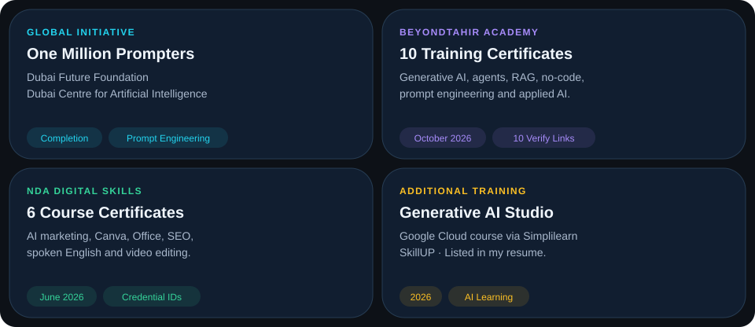
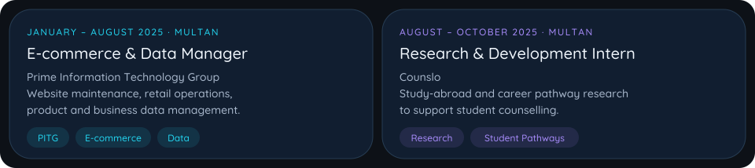
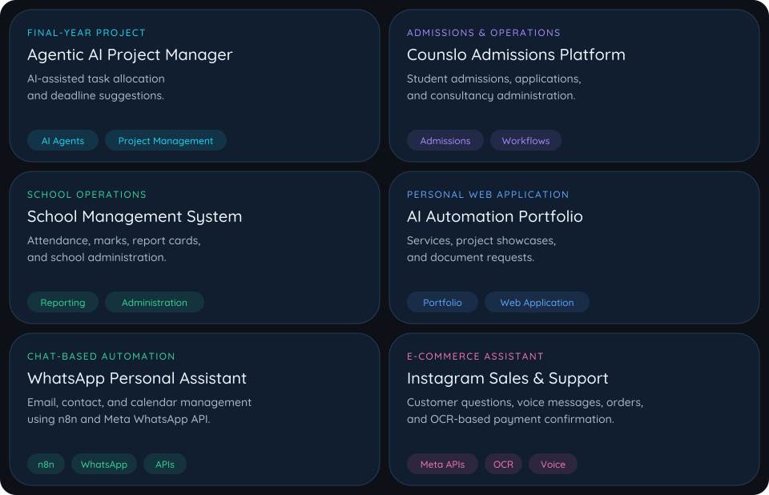

### AI Agents &nbsp; / &nbsp; CRM Systems &nbsp; / &nbsp; Full-Stack & SaaS

**I build AI-powered workflows, CRM systems, and full-stack SaaS applications.**

📍 Multan, Pakistan &nbsp; · &nbsp; 🤝 Open to projects & collaboration

[About](#-about-me) · [Skills](#-my-toolkit) · [Certifications](#-training--recognition) · [Experience](#-professional-experience) · [Projects](#-project-highlights) · [Activity](#-github-activity)

## 👋 About Me

I'm <strong>Hammad Hussain</strong>, an <strong>AI Automation & Agentic AI Developer</strong> who also builds <strong>CRM systems, full-stack web applications, and SaaS products</strong>.

I combine <strong>n8n, Python, AI agents, and APIs</strong> with <strong>no-code, low-code, and AI-assisted development (vibe coding)</strong> to turn business ideas into working applications.

My work covers user interfaces, backend APIs, databases, dashboards, and automation — with a focus on practical business needs.

🎓 **BS Computer Science** · University of Southern Punjab · 2022–2026  
🔬 **Final-year project:** Agentic AI Project Manager  
💡 **Focus:** AI agents · CRM development · SaaS products · Business automation

## ⚡ What I Build

<table>
<tr>
<td width="50%" valign="top">
<h3>🤖 AI Agents & Automation</h3>
AI agents with tool calling, n8n workflows, webhooks, and connected business tools.
</td>
<td width="50%" valign="top">
<h3>💬 Conversational Systems</h3>
WhatsApp, Instagram, Messenger, and voice agent integrations for customer communication.
</td>
</tr>
<tr>
<td width="50%" valign="top">
<h3>🧠 Knowledge & Retrieval</h3>
RAG, embeddings, vector databases, OCR, and document search.
</td>
<td width="50%" valign="top">
<h3>🌐 Full-Stack Web Applications</h3>
User interfaces, backend APIs, databases, dashboards, and administrative portals.
</td>
</tr>
<tr>
<td width="50%" valign="top">
<h3>📊 Custom CRM Systems</h3>
Lead tracking, customer records, sales pipelines, follow-ups, and workflow automation.
</td>
<td width="50%" valign="top">
<h3>🚀 SaaS & Product Development</h3>
MVPs and SaaS applications built with code, no-code tools, and AI-assisted development.
</td>
</tr>
</table>

## 🛠 My Toolkit

<b>AUTOMATION &amp; DEVELOPMENT</b>

  
  
  
  
  

<b>APPLICATION &amp; PRODUCT DEVELOPMENT</b>

  
  
  
  
  

<b>AI &amp; KNOWLEDGE SYSTEMS</b>

  
  
  
  
  

<b>CLOUD, DATABASES &amp; DEPLOYMENT</b>

  
  
  
  

<b>AI CODING &amp; VIBE CODING</b>

  
  
  
  
  

<b>APIs &amp; INTEGRATIONS</b>

  
  
  
  
  

## 🏅 Training & Recognition

<b>View all certificates, credential IDs & verification links</b>

### 🌍 One Million Prompters

**Certificate of completion** · Dubai Future Foundation & Dubai Centre for Artificial Intelligence  
Training in prompt engineering for AI systems.  
**Credential ID / verification link:** Not printed on the supplied certificate.

### 🧠 BeyondTahir Academy · 10 Certificates

Issued **22 October 2026**. Document types are shown as printed on the certificates. Verification links were decoded directly from their QR codes; current verification results have not been independently confirmed.

| Programme | Certificate type | Credential ID | Verification |
| :--- | :--- | :--- | :--- |
| Introduction to Generative AI | Completion | BTA-2026-1124C2 | [Verify](https://academy.beyondtahir.com/verify/BTA-2026-1124C2) |
| AI Agents & Automation for Beginners | Completion | BTA-2026-9AED1E | [Verify](https://academy.beyondtahir.com/verify/BTA-2026-9AED1E) |
| AI for Content Creation | Completion | BTA-2026-3F909A | [Verify](https://academy.beyondtahir.com/verify/BTA-2026-3F909A) |
| RAG Engineering: Build AI That Knows Your Data | Completion | BTA-2026-782D2C | [Verify](https://academy.beyondtahir.com/verify/BTA-2026-782D2C) |
| Intro to AI for Humans | Completion | BTA-2026-FB72E5 | [Verify](https://academy.beyondtahir.com/verify/BTA-2026-FB72E5) |
| Certification in Prompt Engineering (BTA-CPE) | Appreciation | BTA-2026-17D3EE | [Verify](https://academy.beyondtahir.com/verify/BTA-2026-17D3EE) |
| No Code: Build Anything Without Coding | Appreciation | BTA-2026-298135 | [Verify](https://academy.beyondtahir.com/verify/BTA-2026-298135) |
| AI for Students: From Learning to Earning | Appreciation | BTA-2026-3C64DC | [Verify](https://academy.beyondtahir.com/verify/BTA-2026-3C64DC) |
| AI for Doctors & Researchers | Appreciation | BTA-2026-5EC1E7 | [Verify](https://academy.beyondtahir.com/verify/BTA-2026-5EC1E7) |
| Applied AI in Law | Appreciation | BTA-2026-70F1D3 | [Verify](https://academy.beyondtahir.com/verify/BTA-2026-70F1D3) |

### 🎨 NDA Digital Skills · 6 Certificates

Six **1.5-month courses**, with certificates of completion issued **6 June 2026**.

| Programme | Credential ID |
| :--- | :--- |
| AI Social Media Marketing | 22840 |
| Canva & Freelancing | 57595 |
| Microsoft Office | 96386 |
| SEO Content Writing With AI | 48617 |
| Spoken English | 38966 |
| Video Editing & AI | 10469 |

**Verification:** Open the [official NDA portal](https://portal.nda.com.pk/), choose **Certificate Verification**, and enter the credential ID. These IDs are transcribed from my digital certificates; online acceptance has not been confirmed.

### ☁️ Additional Training

**Introduction to Generative AI Studio** · Google Cloud course via Simplilearn SkillUP · 2026  
*Listed in my resume. Credential ID and verification link were not available in the reviewed materials.*

## 💼 Professional Experience

Read experience details

**E-commerce & Data Manager · Prime Information Technology Group (PITG)**  
January–August 2025 · Multan  
Website maintenance, e-commerce operations, and product and business data management.

**Research & Development Intern · Counslo**  
August–October 2025 · Multan  
Research into study-abroad options and student career pathways to support counselling.

## 🚀 Project Highlights

Read project descriptions

<table>
<tr>
<td width="50%" valign="top">
<h3>🤖 Agentic AI Project Manager</h3>
Final-year project exploring AI-assisted project management.
  
<code>Agentic AI</code> <code>Project Management</code>
</td>
<td width="50%" valign="top">
<h3>🎓 Counslo Admissions Platform</h3>
Student admissions, applications, and consultancy administration.
  
<code>Admissions</code> <code>Administrative Workflows</code>
</td>
</tr>
<tr>
<td width="50%" valign="top">
<h3>🏫 School Management System</h3>
Attendance, marks, report cards, and school administration.
  
<code>School Operations</code> <code>Reporting</code>
</td>
<td width="50%" valign="top">
<h3>🌐 AI Automation Portfolio</h3>
Services, project showcases, and document requests.
  
<a href="https://maharhammadhussainsial.space-z.ai"><b>Explore my portfolio →</b></a>
</td>
</tr>
</table>

### 💬 AI Assistant Projects

| Project | Work described in my resume |
| :--- | :--- |
| **WhatsApp Personal Assistant** | Chat-based email, contact, and calendar management using n8n and the Meta WhatsApp API |
| **Instagram Sales & Support Assistant** | Customer questions, voice messages, order workflows, and OCR-based payment confirmation for an e-commerce brand |

Project source repositories are currently private. Visit my portfolio to explore my work.

## 📈 GitHub Activity

Cards refresh automatically through an external service; cached results may lag behind GitHub. Private repository details are not included.

---

### Have an app idea or a workflow to automate?

**Let's build your CRM, SaaS product, or AI automation system.**

AI Automation · Agentic AI · CRM Systems · Full-Stack Development · SaaS

