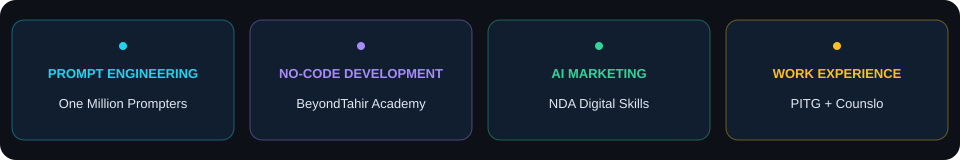

### AI Agents &nbsp; / &nbsp; CRM Systems &nbsp; / &nbsp; Full-Stack & SaaS

**I build AI-powered workflows, CRM systems, and full-stack SaaS applications.**

📍 Multan, Pakistan &nbsp; · &nbsp; 🤝 Open to projects & collaboration

[About](#-about-me) · [Skills](#-my-toolkit) · [Projects](#-project-highlights) · [Activity](#-github-activity)

## 👋 About Me

I'm **Hammad Hussain**, an **AI Automation & Agentic AI Developer** who also builds **CRM systems, full-stack web applications, and SaaS products**.

I combine **n8n, Python, AI agents, and APIs** with **no-code, low-code, and AI-assisted development (vibe coding)** to turn business ideas into working applications.

My work covers user interfaces, backend APIs, databases, dashboards, and automation — with a focus on practical business needs.

🎓 **BS Computer Science** · University of Southern Punjab · 2022–2026  
🔬 **Final-year project:** Agentic AI Project Manager  
💡 **Focus:** AI agents · CRM development · SaaS products · Business automation

## ⚡ What I Build

<table>
<tr>
<td width="50%" valign="top">
<h3>🤖 AI Agents & Automation</h3>
AI agents with tool calling, n8n workflows, webhooks, and connected business tools.
</td>
<td width="50%" valign="top">
<h3>💬 Conversational Systems</h3>
WhatsApp, Instagram, Messenger, and voice agent integrations for customer communication.
</td>
</tr>
<tr>
<td width="50%" valign="top">
<h3>🧠 Knowledge & Retrieval</h3>
RAG, embeddings, vector databases, OCR, and document search.
</td>
<td width="50%" valign="top">
<h3>🌐 Full-Stack Web Applications</h3>
User interfaces, backend APIs, databases, dashboards, and administrative portals.
</td>
</tr>
<tr>
<td width="50%" valign="top">
<h3>📊 Custom CRM Systems</h3>
Lead tracking, customer records, sales pipelines, follow-ups, and workflow automation.
</td>
<td width="50%" valign="top">
<h3>🚀 SaaS & Product Development</h3>
MVPs and SaaS applications built with code, no-code tools, and AI-assisted development.
</td>
</tr>
</table>

## 🛠 My Toolkit

View toolkit as text

| Area | Tools & skills |
| :--- | :--- |
| Automation & Development | n8n · Python · SQL · Git · GitHub |
| Application & Product Development | Full-Stack · CRM · SaaS · No-Code · Vibe Coding |
| AI & Knowledge Systems | AI Agents · RAG · Tool Calling · Prompt Engineering · Vector Databases |
| Cloud, Databases & Deployment | Supabase · Vercel · Cloudflare · Firebase |
| AI Coding & Vibe Coding | Codex · Claude Code · Chat Z AI · Lovable · Trae |
| APIs & Integrations | Meta APIs · WhatsApp · REST APIs · Webhooks · Google Workspace |

## 🏅 Training & Recognition

### 🌍 One Million Prompters

**Certificate of completion** · Dubai Future Foundation & Dubai Centre for Artificial Intelligence  
Training in prompt engineering for AI systems.

### 🧠 BeyondTahir Academy · 10 Certificates

Issued **22 October 2026**. Document types are shown as printed on the certificates.

| Programme | Certificate type |
| :--- | :--- |
| Introduction to Generative AI | Completion |
| AI Agents & Automation for Beginners | Completion |
| AI for Content Creation | Completion |
| RAG Engineering: Build AI That Knows Your Data | Completion |
| Intro to AI for Humans | Completion |
| Certification in Prompt Engineering (BTA-CPE) | Appreciation |
| No Code: Build Anything Without Coding | Appreciation |
| AI for Students: From Learning to Earning | Appreciation |
| AI for Doctors & Researchers | Appreciation |
| Applied AI in Law | Appreciation |

### 🎨 NDA Digital Skills · 6 Certificates

Six **1.5-month courses**, with certificates of completion issued **6 June 2026**.

| Programme | Certificate type |
| :--- | :--- |
| AI Social Media Marketing | Completion |
| Canva & Freelancing | Completion |
| Microsoft Office | Completion |
| SEO Content Writing With AI | Completion |
| Spoken English | Completion |
| Video Editing & AI | Completion |

### ☁️ Additional Training

**Introduction to Generative AI Studio** · Google Cloud course via Simplilearn SkillUP · 2026  
*Listed in my resume.*

## 💼 Professional Experience

**E-commerce & Data Manager · Prime Information Technology Group (PITG)**  
January–August 2025 · Multan  
Website maintenance, e-commerce operations, and product and business data management.

**Research & Development Intern · Counslo**  
August–October 2025 · Multan  
Research into study-abroad options and student career pathways to support counselling.

## 🚀 Project Highlights

<table>
<tr>
<td width="50%" valign="top">
<h3>🤖 Agentic AI Project Manager</h3>
Final-year project exploring AI-assisted project management.
  
<code>Agentic AI</code> <code>Project Management</code>
</td>
<td width="50%" valign="top">
<h3>🎓 Counslo Admissions Platform</h3>
Student admissions, applications, and consultancy administration.
  
<code>Admissions</code> <code>Administrative Workflows</code>
</td>
</tr>
<tr>
<td width="50%" valign="top">
<h3>🏫 School Management System</h3>
Attendance, marks, report cards, and school administration.
  
<code>School Operations</code> <code>Reporting</code>
</td>
<td width="50%" valign="top">
<h3>🌐 AI Automation Portfolio</h3>
Services, project showcases, and document requests.
  
<a href="https://maharhammadhussainsial.space-z.ai"><b>Explore my portfolio →</b></a>
</td>
</tr>
</table>

### 💬 AI Assistant Projects

| Project | Work described in my resume |
| :--- | :--- |
| **WhatsApp Personal Assistant** | Chat-based email, contact, and calendar management using n8n and the Meta WhatsApp API |
| **Instagram Sales & Support Assistant** | Customer questions, voice messages, order workflows, and OCR-based payment confirmation for an e-commerce brand |

Project source repositories are currently private. Visit my portfolio to explore my work.

## 📈 GitHub Activity

Cards refresh automatically through an external service; cached results may lag behind GitHub. Private repository details are not included.

---

### Have an app idea or a workflow to automate?

**Let's build your CRM, SaaS product, or AI automation system.**

AI Automation · Agentic AI · CRM Systems · Full-Stack Development · SaaS

