<a href="https://maharhammadhussainsial.vercel.app/">
  
</a>

  
  
  


<a href="https://kps-school-portal.vercel.app/login">
  
</a>

<a href="https://maharhammadhussainsial.vercel.app/">
  
</a>

<a href="https://maharhammadhussainsial.vercel.app/">
  
</a>

<a href="https://maharhammadhussainsial.vercel.app/">
  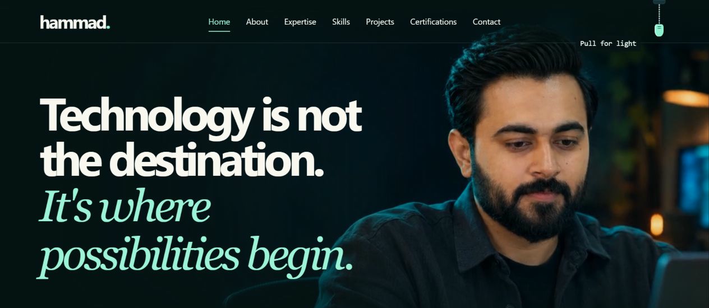
</a>

  
  
  

### Client portfolio websites

<a href="https://github.com/hammadfidasial/dr-ansha-khadim-portfolio-web">
  
</a>

<a href="https://github.com/hammadfidasial/dr-haseeb-arshad-porfolio-web">
  
</a>

<a href="https://github.com/hammadfidasial/mech-ali-safdar-portfolio-web">
  
</a>

Repository links require GitHub access.

<b>Other projects</b>

- **Instagram Sales & Support** · Conversational AI for support, voice messages, orders and payment OCR.
- **School Management System** · Attendance, marks and report cards.
- **AI Automation Portfolio** · Service and project showcase with document requests.



<a href="https://github.com/hammadfidasial">
  
</a>

  

<b>View all certificates, credential IDs & verification links</b>

### 🌍 One Million Prompters

**Certificate of completion** · Dubai Future Foundation & Dubai Centre for Artificial Intelligence  
Training in prompt engineering for AI systems.  
**Credential ID / verification link:** Not printed on the supplied certificate.

### 🧠 BeyondTahir Academy · 10 Certificates

Issued **22 October 2026**. Document types are shown as printed on the certificates. Verification links were decoded directly from their QR codes; current verification results have not been independently confirmed.

| Programme | Certificate type | Credential ID | Verification |
| :--- | :--- | :--- | :--- |
| Introduction to Generative AI | Completion | BTA-2026-1124C2 | [Verify](https://academy.beyondtahir.com/verify/BTA-2026-1124C2) |
| AI Agents & Automation for Beginners | Completion | BTA-2026-9AED1E | [Verify](https://academy.beyondtahir.com/verify/BTA-2026-9AED1E) |
| AI for Content Creation | Completion | BTA-2026-3F909A | [Verify](https://academy.beyondtahir.com/verify/BTA-2026-3F909A) |
| RAG Engineering: Build AI That Knows Your Data | Completion | BTA-2026-782D2C | [Verify](https://academy.beyondtahir.com/verify/BTA-2026-782D2C) |
| Intro to AI for Humans | Completion | BTA-2026-FB72E5 | [Verify](https://academy.beyondtahir.com/verify/BTA-2026-FB72E5) |
| Certification in Prompt Engineering (BTA-CPE) | Appreciation | BTA-2026-17D3EE | [Verify](https://academy.beyondtahir.com/verify/BTA-2026-17D3EE) |
| No Code: Build Anything Without Coding | Appreciation | BTA-2026-298135 | [Verify](https://academy.beyondtahir.com/verify/BTA-2026-298135) |
| AI for Students: From Learning to Earning | Appreciation | BTA-2026-3C64DC | [Verify](https://academy.beyondtahir.com/verify/BTA-2026-3C64DC) |
| AI for Doctors & Researchers | Appreciation | BTA-2026-5EC1E7 | [Verify](https://academy.beyondtahir.com/verify/BTA-2026-5EC1E7) |
| Applied AI in Law | Appreciation | BTA-2026-70F1D3 | [Verify](https://academy.beyondtahir.com/verify/BTA-2026-70F1D3) |

### 🎨 NDA Digital Skills · 6 Certificates

Six **1.5-month courses**, with certificates of completion issued **6 June 2026**.

| Programme | Credential ID |
| :--- | :--- |
| AI Social Media Marketing | 22840 |
| Canva & Freelancing | 57595 |
| Microsoft Office | 96386 |
| SEO Content Writing With AI | 48617 |
| Spoken English | 38966 |
| Video Editing & AI | 10469 |

**Verification:** Open the [official NDA portal](https://portal.nda.com.pk/), choose **Certificate Verification**, and enter the credential ID. These IDs are transcribed from my digital certificates; online acceptance has not been confirmed.

### ☁️ Additional Training

**Introduction to Generative AI Studio** · Google Cloud course via Simplilearn SkillUP · 2026  
*Listed in my resume. Credential ID and verification link were not available in the reviewed materials.*


  
  
  

